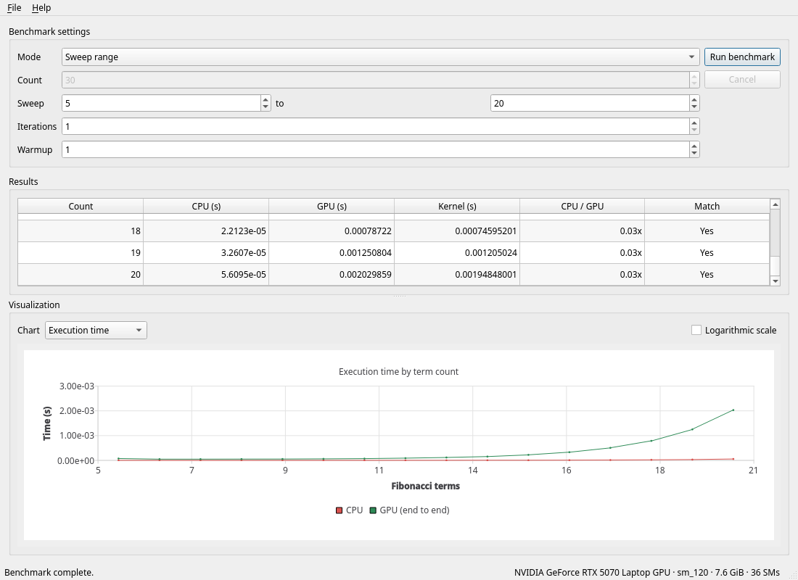

# Fibonacci CUDA Benchmark

[](https://github.com/amir-khoshdel-louyeh/fibonacci-algorithm-with-cuda/actions/workflows/ci.yml)

A C++17 and CUDA benchmark that compares a recursive Fibonacci implementation
on the CPU with a single-threaded CUDA kernel. It ships with a Qt 6 desktop
application for running benchmarks, exploring the results in charts, and
exporting data, plus a scriptable command-line interface.

The GPU path is intentionally sequential. This project is a transparent
demonstration of CUDA execution and transfer overhead, not a claim that this
workload benefits from GPU parallelism.



## Features

- Qt 6 desktop GUI with single-count and sweep modes
- Configurable measured iterations and warmup runs
- Background worker thread with progress reporting and cancellation
- Results table with CPU time, GPU time, kernel time, speedup, and match status
- Interactive execution-time and CPU/GPU speedup charts
- Linear and logarithmic time axes
- CSV and JSON export, CSV session loading, and PNG chart export
- Command-line interface with the same benchmark engine
- CPU/GPU result validation and clear CUDA error messages
- Automated core, I/O, CLI, and GUI smoke tests
- CMake install rules, desktop entry, icon, and CPack packaging

## Requirements

See [REQUIREMENTS.md](REQUIREMENTS.md) for the full list and distro-specific
install commands. At minimum you need:

- A CUDA-capable NVIDIA GPU and a compatible driver
- CUDA Toolkit with `nvcc` and the CUDART development headers
- CMake 3.24+, a C++17 compiler
- Qt 6.5+ Widgets and Charts for the GUI

## Build

Using CMake presets:

```bash
cmake --preset release
cmake --build --preset release
ctest --preset release
```

Run the GUI or the CLI:

```bash
./build/fibonacci_gui
./build/fibonacci_cuda --help
```

Build without Qt:

```bash
cmake --preset cli-only
cmake --build --preset cli-only
ctest --preset cli-only
```

Or configure manually:

```bash
cmake -S . -B build -DCMAKE_BUILD_TYPE=Release
cmake --build build
ctest --test-dir build --output-on-failure
```

Pass `-DBUILD_GUI=OFF` to skip the Qt application.

## GUI

Start `./build/fibonacci_gui` and choose a mode:

- **Single count** computes all terms up to the selected count once per
  iteration.
- **Sweep range** benchmarks every count between the start and end values.

Set the number of measured iterations and warmup runs, then press **Run
benchmark**. Results appear in the table and charts as they are produced. The
**File** menu can open a previously exported CSV session, save results as CSV
or JSON, and export the current chart as a PNG image.

## CLI

```bash
# Single benchmark with median timing
./build/fibonacci_cuda --count 30 --iterations 5 --warmup 1

# Sweep and export both formats
./build/fibonacci_cuda --sweep 5 30 --csv sweep.csv --json sweep.json
```

Available options:

```text
--count N       Number of Fibonacci terms (1-47, default 5)
--sweep A B     Benchmark every term count from A through B
--iterations N  Measured runs per implementation, median reported (default 3)
--warmup N      Unmeasured runs before timing (default 1)
--csv PATH      Write benchmark results as CSV
--json PATH     Write benchmark results as JSON
--help          Show usage
```

## Benchmark methodology

- The program computes Fibonacci terms `0` through `N - 1` for both
  implementations.
- Warmup runs initialize the CUDA context and caches before any measurement, so
  first-launch overhead does not distort the results.
- Each implementation runs `iterations` times and the **median** is reported.
- CPU timing wraps the whole computation with `std::chrono::high_resolution_clock`.
- GPU end-to-end timing includes allocation, kernel launch, synchronization, and
  the device-to-host copy.
- GPU kernel time is measured separately with CUDA events.
- CPU and GPU outputs are compared element by element. A mismatch is reported
  in the GUI and makes the CLI exit with a nonzero status.

The implementation is deliberately recursive and therefore exponential. The
47-term upper bound prevents signed 32-bit overflow. Large counts and wide
sweeps can take a long time, especially on the CPU.

## Data formats

CSV output uses schema version 1. Each benchmark produces one CPU row and one
GPU row:

```csv
schema_version,implementation,count,iterations,duration_seconds,kernel_seconds,results_match
1,cpu,5,3,4.2e-06,,true
1,gpu,5,3,1.7e-04,6.1e-05,true
```

`kernel_seconds` is empty for CPU rows. The CSV reader also accepts the older
four-column layout (`implementation,count,duration_seconds,results_match`).

JSON output contains the same schema version and one object per benchmark:

```json
{
  "schema_version": 1,
  "results": [
    {
      "count": 5,
      "iterations": 3,
      "cpu_seconds": 4.2e-06,
      "gpu_seconds": 1.7e-04,
      "gpu_kernel_seconds": 6.1e-05,
      "results_match": true
    }
  ]
}
```

## Project layout

```text
src/fibonacci_core.{h,cu}   CPU/CUDA benchmark engine and device information
src/benchmark_io.{h,cpp}    Versioned CSV/JSON export and CSV import
src/main.cpp                Command-line interface
src/gui/                    Qt 6 application, charts, and worker thread
tests/                      Core, I/O, and GUI smoke tests
packaging/                  Desktop entry and application icon
docs/                       Screenshots
```

## Testing and CI

```bash
ctest --test-dir build --output-on-failure
```

The suite covers the Fibonacci sequence, benchmark invariants, CSV
round-tripping with legacy files, CLI argument handling, and a headless GUI
smoke test that runs a real benchmark. Tests that need a GPU skip themselves
when no CUDA device is available.

The GitHub Actions workflow builds inside an NVIDIA CUDA container with Qt 6
and runs the full suite using the offscreen Qt platform.

## Install and packaging

```bash
cmake --install build --prefix /usr/local

cd build
cpack                # TGZ by default
cpack -G RPM         # requires rpmbuild
```

The install step places both binaries in `bin`, plus the desktop entry and icon
under `share`. Set `CPACK_GENERATOR` to produce other package formats.

## Limitations

- The CUDA kernel uses one thread by design, so it will not outperform the CPU
  for this workload.
- Absolute timings depend on clocks, thermals, driver version, and system load.
  Compare medians and trends rather than single measurements.
- CUDA does not run on macOS.

## License

This project is licensed under the MIT License. See [LICENSE](LICENSE).

## Author

Amir Khoshdel Louyeh
