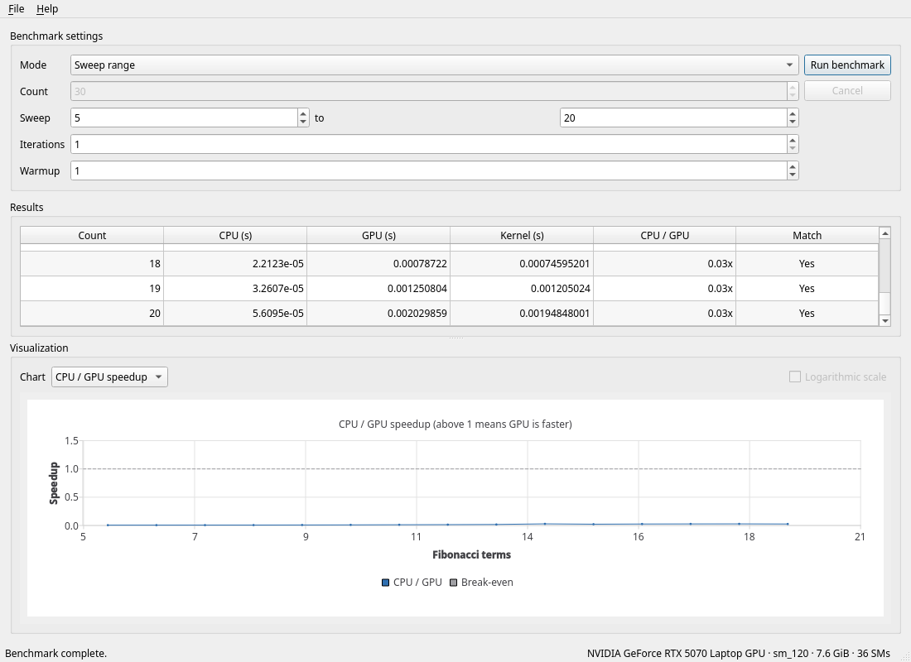

# Fibonacci CUDA Benchmark

A C++17 / CUDA benchmark and Qt 6 desktop application that measures exactly what a GPU costs when the workload cannot be parallelised — comparing a recursive CPU implementation with a deliberately single-threaded CUDA kernel.


`C++17` · `CUDA` · `Qt 6` · Benchmark / systems programming · Complete

## At a glance

| | |
|---|---|
| **Question** | What does CUDA cost when there is no parallelism to exploit? |
| **Implementations** | Recursive CPU Fibonacci vs. one-thread GPU kernel |
| **Interfaces** | Qt 6 GUI (single-count + sweep, charts, CSV/JSON export) and CLI |
| **Validation** | Element-wise CPU/GPU comparison on every run |
| **Verification** | **5/5 CTest tests pass** — core, I/O round-trip, CLI validation, GUI smoke |
| **Measured on** | RTX 5070 Laptop (8 GB), CUDA 13, Linux |
| **Role** | Solo — kernel, benchmark engine, GUI, packaging, CI |

## Overview

Most CUDA demos are written to show a speed-up. This one is written to show the opposite honestly: Fibonacci has a serial dependency chain, so the kernel runs on a **single thread**, and the benchmark exposes the real cost of allocation, launch, synchronisation and the device-to-host copy.

The result is a clean, reproducible demonstration of when *not* to use a GPU. At 30 terms the CPU finishes in **6.55 ms** while the GPU path takes **239 ms** — roughly **37× slower** — even though the kernel itself accounts for almost all of that time (239 ms of 239 ms end-to-end). The gap is execution, not transfer: a one-thread kernel is a very expensive way to run a serial loop.

## Results

CLI sweep, median of 3 measured iterations after 1 warm-up (`./build/fibonacci_cuda --sweep 15 30 --iterations 3 --warmup 1`):

| Terms | CPU | GPU end-to-end | GPU kernel | GPU / CPU |
|---:|---:|---:|---:|---:|
| 15 | 4.90 µs | 225 µs | 179 µs | 45.9× slower |
| 20 | 57.4 µs | 1.996 ms | 1.947 ms | 34.8× slower |
| 25 | 587 µs | 21.66 ms | 21.58 ms | 36.9× slower |
| 30 | 6.55 ms | 239.4 ms | 239.2 ms | 36.6× slower |

All 32 sweep rows (15–30) reported `Match = Yes`; CPU and GPU sequences were identical. The steady ~35–45× ratio shows that the overhead scales with the work rather than being a fixed launch cost — the kernel is simply running an exponential serial algorithm on one GPU thread at a lower clock than the CPU.



**Environment:** NVIDIA GeForce RTX 5070 Laptop GPU, 8 GB, driver 620.70, Linux. Absolute timings vary with clocks, thermals and driver version; compare medians and trends, not single samples.

## Features

- **Qt 6 GUI** — single-count and sweep modes, sortable results table, execution-time and speedup charts, linear/log axes
- **Background worker thread** — progress reporting and cancellation; the UI stays responsive during long sweeps
- **Scriptable CLI** — the same benchmark engine with `--count`, `--sweep`, `--iterations`, `--warmup`, `--csv`, `--json`
- **Versioned data formats** — CSV/JSON schema v1, CSV session import (including the legacy four-column layout), PNG chart export
- **Correctness first** — every run compares CPU and GPU outputs element by element; a mismatch fails the CLI with a non-zero exit code
- **GPU diagnostics** — device name, compute capability, memory and clear CUDA error messages
- **Packaging** — CMake install rules, desktop entry, icon, CPack TGZ/RPM output

## Architecture

```text
┌─────────────────────────────┐
│ GUI (Qt 6)                  │
│ MainWindow · ChartWidget    │
│ BenchmarkWorker (QThread)   │
└──────────────┬──────────────┘
               │ same engine
┌──────────────▼──────────────┐
│ CLI (src/main.cpp)          │
└──────────────┬──────────────┘
               ▼
┌─────────────────────────────┐
│ fibonacci_core (CUDA)       │
│ recursive CPU + 1-thread GPU│
│ CUDA events for kernel time │
└──────────────┬──────────────┘
               ▼
┌─────────────────────────────┐
│ benchmark_io (C++17)        │
│ versioned CSV / JSON        │
└─────────────────────────────┘
```

The GUI links the same static `fibonacci_core` and `fibonacci_io` libraries as the CLI, so a number produced in the window and a number produced by a script come from identical code paths. GPU end-to-end timing wraps allocation, launch, `cudaDeviceSynchronize` and the D2H copy; kernel time is measured independently with CUDA events, which is why the two columns are close but not equal.

## Benchmark methodology

- Terms `0 … N−1` are computed for both implementations.
- Warm-up runs initialise the CUDA context before any measurement.
- Each implementation runs `iterations` times; the **median** is reported.
- CPU timing uses `std::chrono::high_resolution_clock`.
- Counts are capped at 47 to prevent signed 32-bit overflow; the recursion is exponential by design.
- A mismatch is surfaced in the GUI and returned as a CLI failure, never silently ignored.

## Repository structure

```text
.
├── src/
│   ├── fibonacci_core.cu / .h    # CPU + CUDA engines, device info
│   ├── benchmark_io.cpp / .h     # Versioned CSV/JSON export and import
│   ├── main.cpp                  # CLI
│   └── gui/                      # Qt window, charts, worker thread
├── tests/                        # Core, I/O, CLI and headless GUI tests
├── packaging/                    # Desktop entry and icon
├── docs/                         # Screenshots
├── CMakeLists.txt · CMakePresets.json
└── .github/workflows/ci.yml      # CUDA container build + full test suite
```

## Build and run

Requires a CUDA-capable NVIDIA GPU, the CUDA Toolkit, CMake ≥ 3.24, a C++17 compiler, and Qt 6.5+ (Widgets, Charts) for the GUI. Distro-specific instructions are in [`REQUIREMENTS.md`](REQUIREMENTS.md).

```bash
cmake --preset release
cmake --build --preset release
ctest --preset release

./build/fibonacci_gui             # desktop app
./build/fibonacci_cuda --help     # CLI
```

CLI-only build (no Qt):

```bash
cmake --preset cli-only
cmake --build --preset cli-only
ctest --preset cli-only
```

`python3 main.py` launches the compiled GUI using only the standard library.

## Usage

```bash
# Single benchmark, median of 5 runs
./build/fibonacci_cuda --count 30 --iterations 5 --warmup 1

# Sweep and export both formats
./build/fibonacci_cuda --sweep 5 30 --csv sweep.csv --json sweep.json
```

| Flag | Meaning |
|---|---|
| `--count N` | Number of Fibonacci terms (1–47, default 5) |
| `--sweep A B` | Benchmark every count from A through B |
| `--iterations N` | Measured runs per implementation (default 3) |
| `--warmup N` | Unmeasured runs first (default 1) |
| `--csv PATH` / `--json PATH` | Export results |

## Testing

```bash
ctest --test-dir build --output-on-failure
```

Current result: **5/5 passed** in 0.84 s — Fibonacci correctness, CSV/JSON round-trip (including the legacy schema), `--help` output, rejection of invalid counts, and a headless GUI smoke test that runs a real benchmark. GPU-dependent tests skip themselves when no CUDA device is present. CI builds inside an NVIDIA CUDA container with Qt 6 and runs the suite on the offscreen platform.

## Limitations

- The kernel is single-threaded by design, so this project measures overhead, not parallel speed-up.
- The implementation is intentionally exponential; large counts and wide sweeps are slow, especially on the CPU.
- CUDA is unavailable on macOS, and timings are not portable across GPUs.
- The chart screenshots show a 5–20 sweep; the table above uses 15–30 for a cleaner exponential range.

## Tech stack

`C++17` · `CUDA` · `Qt 6 Widgets/Charts` · `CMake` · `CTest` · `CPack` · GitHub Actions

## Author

**Amir Khoshdel Louyeh**
[GitHub](https://github.com/amir-khoshdel-louyeh) · [LinkedIn](https://www.linkedin.com/in/amir-khoshdel-louyeh)
